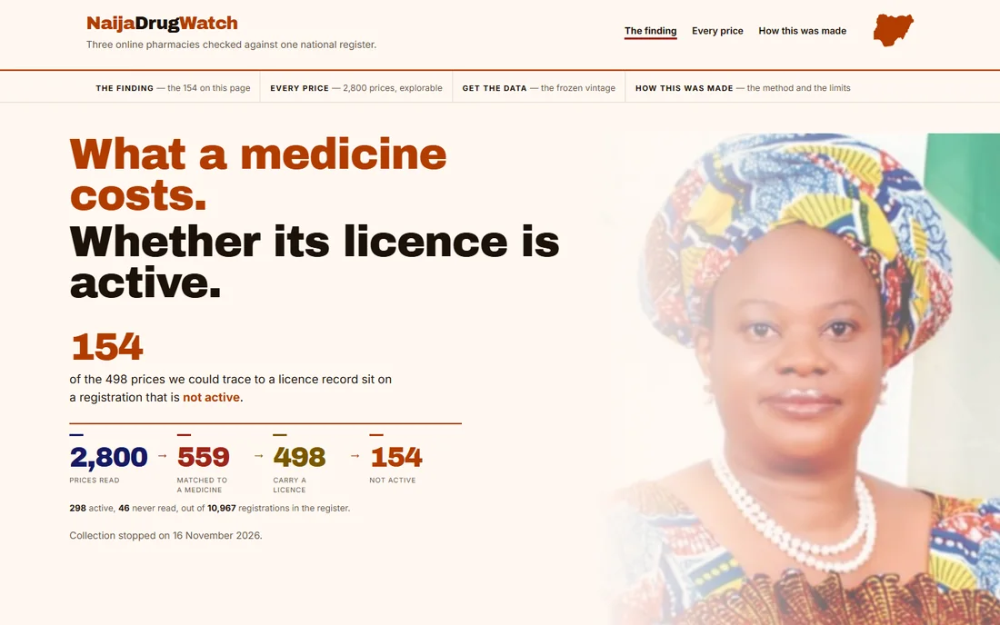
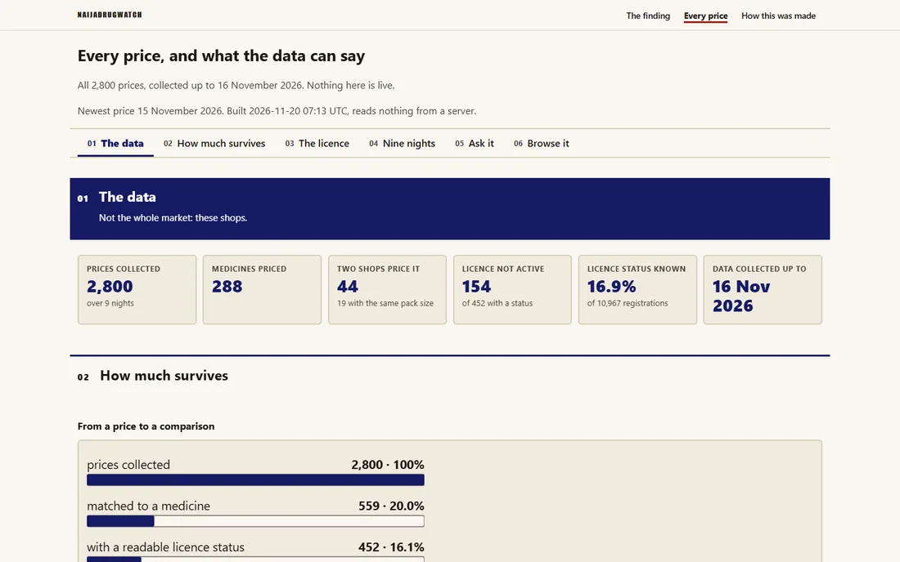
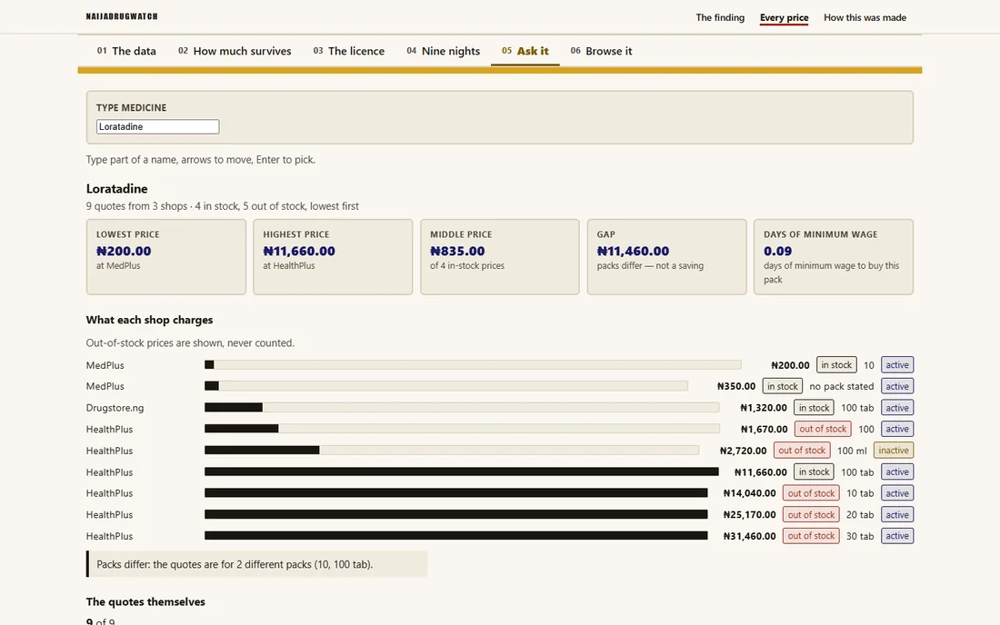
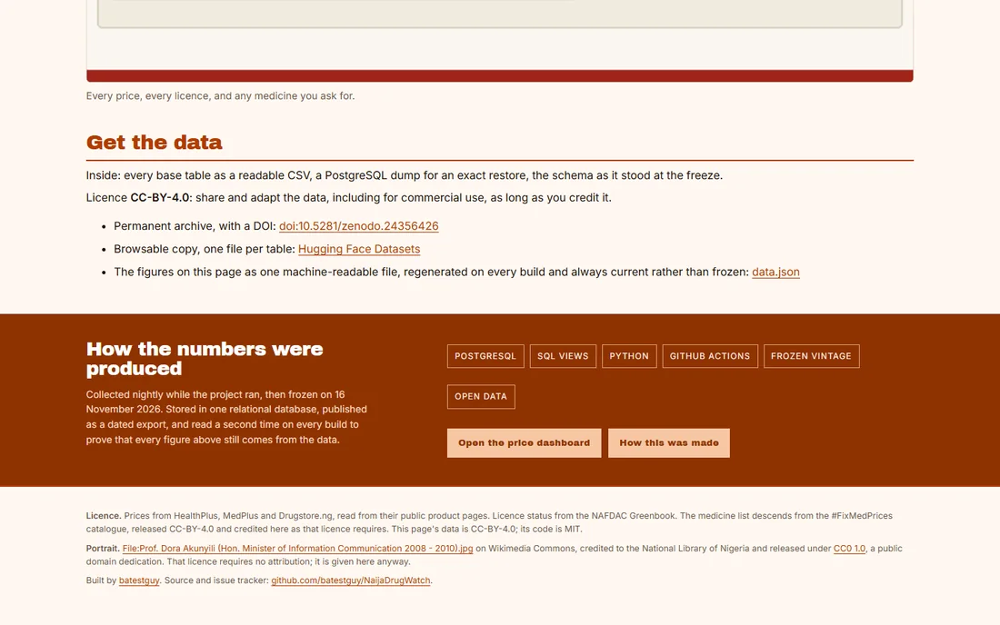
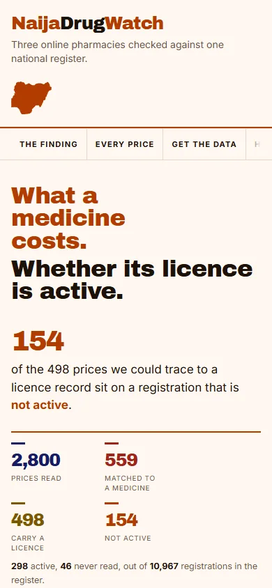
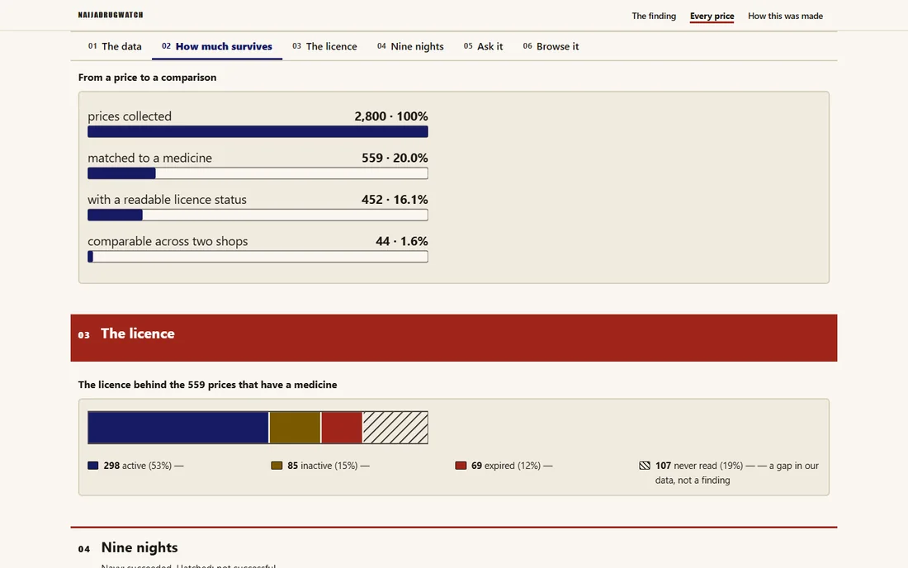
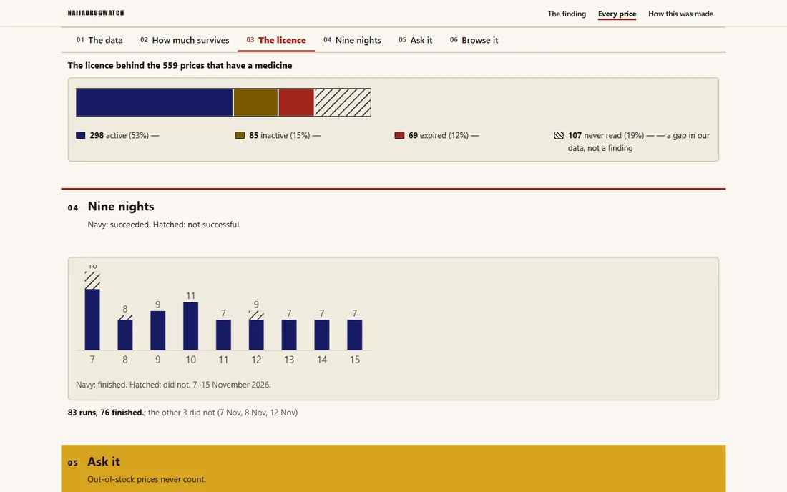
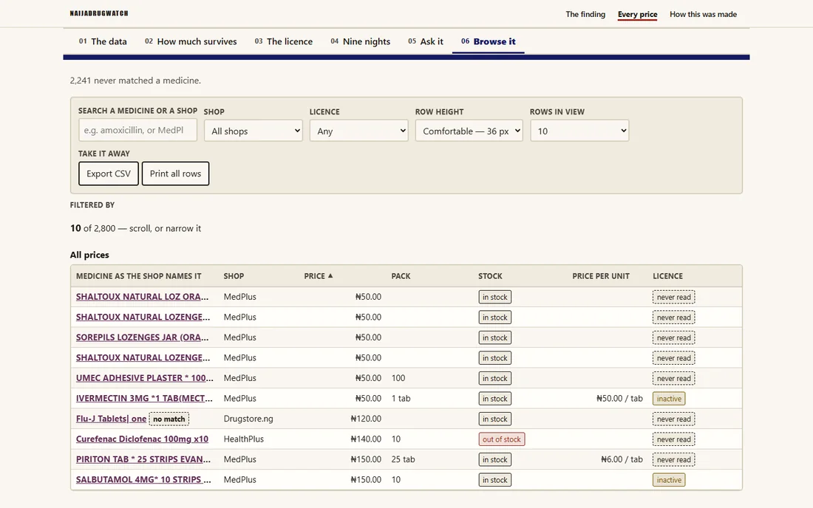
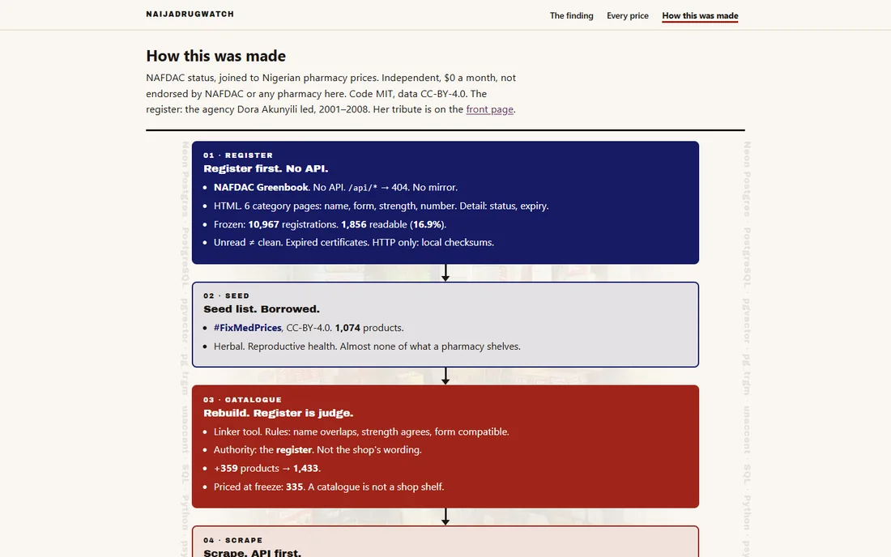
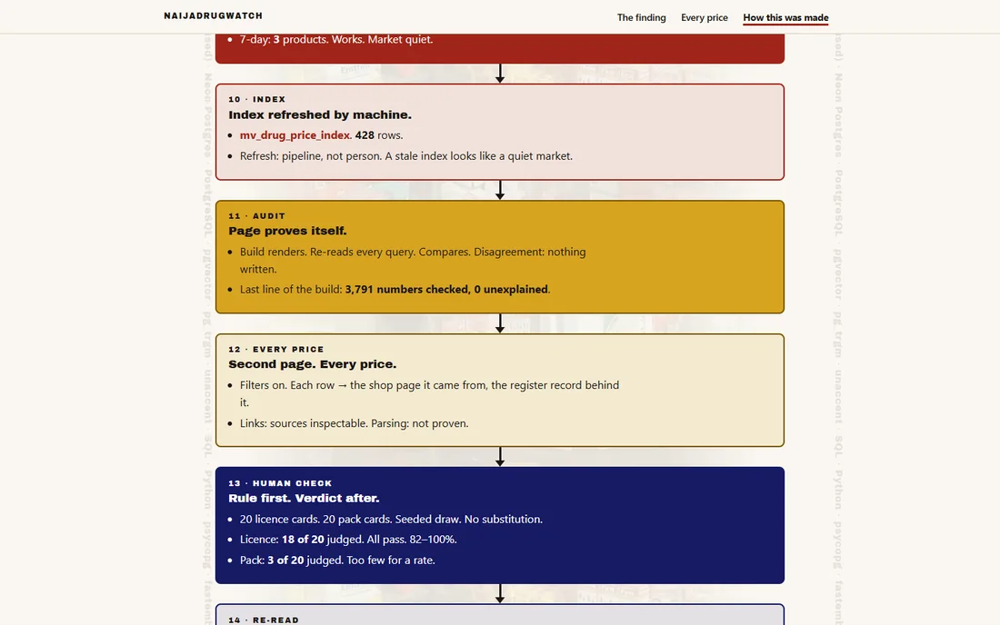

# NaijaDrugWatch

NaijaDrugWatch pairs prices shown on Nigerian pharmacy websites with registration records from NAFDAC's Greenbook, so a reader can see a recorded price beside the licence information collected for that product.

**Status: frozen vintage, and published.** Collection ran from 7 to 15 November 2026 and stopped on 16 November. The three pages are live at **https://batestguy.github.io/NaijaDrugWatch/**, rebuilt from the frozen database whenever the page builders change, and showing what had been collected by 16 November. Nothing behind them updates, so this is not a current price source.

NAFDAC is Nigeria's National Agency for Food and Drug Administration and Control. Its Greenbook is the public source for the registration records used here. The project does not inspect, test or buy medicines. A name match or registration status cannot establish what is inside a pack.

## The pages at a glance



*The finding page places a registration result beside the tally of prices that could be linked to the register.*



*The price page opens with its figures and a funnel showing how collected listings pass through matching.*



*The Ask section shows a medicine search, its shop quotes and a warning that pack size matters.*

## What the data says

The figures below describe the frozen vintage only. “Latest per URL” means the most recent stored price row for each source page in the archive. It does not mean the page still shows that price. A listing appears as matched only when the matching process assigns it to a catalogue product.

| Measure | Frozen-vintage value | What it means |
|---|---:|---|
| Collection period | 7–15 November 2026; stopped on 16 November | At least one recorded price on each of the 9 days, with no gaps |
| Prices on the first price day | 2,709 | Initial full sweep |
| Prices on the last price day | 5 | Final day's records |
| Prices collected, latest per URL | 2,800 | Most recent stored row for each source URL |
| Prices matched to a medicine | 559 | Listings attached to a catalogue product |
| Products in the catalogue | 1,433 | Of these, 335 are cited by at least one recorded price |
| NAFDAC registrations held | 10,967 | Registration records in the frozen vintage |
| Registrations with a scraped status | 1,856 (16.9%) | Status coverage is partial |
| Listings on a registration not marked Active | 154 across 86 products | Stored status only; not a product-safety finding |
| Rows in the cheapest-per-state view | 261 | Only 44 are genuine two-pharmacy comparisons |
| Rows in the materialised price index | 428 | A derived view of the collected records |
| Products with a recorded price move in the last 7 days | 3 | Change within the frozen period, not a current trend |

Read `is_comparison` before calling a row a comparison. It is true only when separate pharmacies quote the same product in the same state. Other rows are single-source prices.

Of the 154 listings attached to a registration not marked Active, the stored status is a reason to check the record, not a verdict about the medicine. Most registrations have no scraped status; unknown remains unknown. The price index summarises the collected records, not the market.

The generated page builds re-check their numbers before writing the pages:

| Build | Rows or figures re-checked | Unexplained |
|---|---:|---:|
| Finding page | 3,791 | 0 |
| Price page | 3,838 | 0 |

These checks show that the page agrees with the values its build reads. They do not prove that an upstream site was parsed correctly or that the displayed registration is the current one.

## The built pages

The repository builds 3 static pages into `site/`, and they are published at **https://batestguy.github.io/NaijaDrugWatch/** by `.github/workflows/pages.yml`. They are generated files, not hand-edited pages: a change to the HTML does not persist, because the next build replaces it. The screenshots below are of those published pages.

### The finding

The navigation label is **The finding**. Its file is `site/index.html`, titled “What a medicine costs. Whether its licence is active.” It leads with the registration result and explains what the numbers count. Its “Get the data” block points to the frozen vintage and describes what is in the archive.



*The download block names the frozen vintage and its public copies.*



*The same finding and data links are arranged for a narrow screen.*

### Every price

The navigation label is **Every price**. Its file is `site/dashboard.html`, titled “Every price, and what the data can say.” It brings together summary figures, a funnel, registration coverage, a medicine search and a browsable table. The search and table are views of the frozen vintage, not a way to request a fresh quote.



*The funnel separates the listings that could be matched from those that could not.*



*The licence section describes the status information available in the frozen vintage.*

The “Browse it” table contains 2,800 price rows. Rows retain references to the source listing and registration record so that a reader can see what each price was linked to.



*The table is searchable and filterable, but its rows remain a dated record.*

### How this was made

The navigation label is **How this was made**. Its file is `site/about.html`, titled “How this was made.” It explains the collection path, the matching decisions, the costs of those decisions and the limitations. It is the methods page, not a current service.



*The methods page starts with the first part of the collection path.*



*Later stages: the price index, the page's own audit and the human check that followed it.*

A redundant Streamlit app remains in `dashboard/app.py`; it is not the dashboard described above.

## How it was made

The source catalogue comes from the #FixMedPrices file. It provides product names, strengths, forms and brand aliases, but it does not provide NAFDAC registration numbers or status. The collection path then ran in this order:

- **Greenbook index:** collect names, forms, strengths and registration numbers.
- **Registration details:** collect status and expiry information within the project's restricted scope.
- **Product-to-registration linking:** attach catalogue products to registration numbers after detail records are available.
- **Pharmacy collection:** read public product and price fields from HealthPlus, MedPlus and Drugstore.ng.
- **Listing matching:** use an embedding-based shortlist, then apply deterministic rules for ingredient, strength and form.
- **Derived views:** refresh the SQL views and materialised price index after matching.

Before the freeze, the pipeline completed successfully on every configured source across consecutive nights. The schedule is now disabled.

The specification called for Prefect. This repository instead used a GitHub Actions schedule, which avoided a separate service and fit the project's free public-repository setup. The trade-off is real: there is no retry engine, run history is limited to the Actions interface, and there is no backfill control. The schedule is off, and nothing in this README should be read as a promise that collection continues.

## What it is built with

| Technique | Role |
|---|---|
| PostgreSQL and SQL | Store source records and define the views used by the pages |
| pgvector | Store product-name embeddings and retrieve likely candidates |
| pg_trgm and unaccent | Help match names despite spelling, spacing or accent differences |
| FastEmbed with `BAAI/bge-small-en-v1.5` on CPU | Produce the embeddings used to shortlist candidates |
| Deterministic matching rules | Reject candidates with incompatible ingredient, strength or form |
| Python and psycopg | Run the loaders, scrapers, matchers and page builders |
| Numbered SQL files | Apply database changes in order; the files are safe to re-run |
| GitHub Actions | Run the collection workflow when its schedule is enabled |
| Generated static HTML with inline SVG | Render the pages without a front-end framework or a page-time network request |

The model and embedding field have to stay in step. A similarity score only proposes candidates; the ingredient, strength and form rules decide whether a match stands. Python generates the pages from stored data, so hand edits to generated output do not persist.

## Quickstart

These commands set up a local database and show the order of the collection steps. They do not enable the schedule, update the frozen vintage or publish the generated pages. Use the pinned Python version and activate `.venv` before running `python` (`.venv\Scripts\Activate.ps1` in PowerShell; `source .venv/bin/activate` in POSIX shells). The remaining commands use a POSIX shell.

```bash
git clone https://github.com/batestguy/NaijaDrugWatch
cd NaijaDrugWatch
uv venv --python 3.12 .venv
uv pip install --python .venv/Scripts/python.exe -r requirements.txt   # Windows
# POSIX: uv pip install --python .venv/bin/python -r requirements.txt

cp .env.example .env
# Put DATABASE_URL in .env, then load it into this shell:
set -a
. ./.env
set +a
```

Apply every numbered SQL file in its filename order, then load the seed catalogue:

```bash
for f in schema/*.sql; do
  psql "$DATABASE_URL" -v ON_ERROR_STOP=1 -f "$f"
done

python scripts/load_seed.py --dry-run
python scripts/load_seed.py
```

For an intentional local collection run, keep the dependency order: registration details before product-to-registration linking, and pharmacy listings before matching.

```bash
python -X utf8 scrapers/nafdac_index.py
python -X utf8 scrapers/nafdac_details.py
python -X utf8 scripts/link_product_nrn.py --refresh
python -X utf8 scrapers/healthplus.py
python -X utf8 scrapers/medplus.py
python -X utf8 scrapers/drugstore.py
python -X utf8 scripts/match_listings.py
psql "$DATABASE_URL" -v ON_ERROR_STOP=1 \
  -c 'REFRESH MATERIALIZED VIEW CONCURRENTLY mv_drug_price_index;'
```

These commands contact source websites. Run them only for an intentional collection with a configured database. A new scrape writes the newest URL row with `product_id` unset. The latest-listing view selects that row, so run the matcher before relying on linked-price views.

Keep `DATABASE_URL` in an ignored local `.env` file or a protected environment variable. Never put a database password in a committed file.

## Data, licence and attribution

The published object is a frozen vintage, not an updating dataset. It contains 8 source tables and 36,936 rows. The frozen archive has 10 files totalling 12,284,353 bytes; the compressed archive is 5,419,983 bytes. Its SHA-256 is:

`209fe7ae2fbdf556201cf419ebc7cf1e9219afdb5280964cb5a424e596d00f1e`

The public copies are:

| Copy | What it contains |
|---|---|
| [GitHub release `vintage-2026-11-16`](https://github.com/batestguy/NaijaDrugWatch/releases/tag/vintage-2026-11-16) | Frozen archive and 11 attached files |
| [Hugging Face `JBZABC/naijadrugwatch`](https://huggingface.co/datasets/JBZABC/naijadrugwatch) | Browsable copy, with one file per table |
| [Zenodo DOI `10.5281/zenodo.24356426`](https://doi.org/10.5281/zenodo.24356426) | Record for the compressed archive |

The archive does not change when a pharmacy edits a page or NAFDAC updates the register. Cite the frozen vintage and its collection period when reusing a figure.

**Code:** MIT, in [`LICENSE`](LICENSE). **Data:** CC-BY-4.0, subject to the terms of each source. The #FixMedPrices catalogue is CC-BY-4.0 and must be credited to Code for Nigeria via openAFRICA. NAFDAC publishes the Greenbook; this project is independent and is not endorsed by NAFDAC or by any pharmacy.

Pharmacy scrapers read public product and price fields; the Greenbook supplies registration references and status. No personal data, reviews, prescription information or login-only material is collected. Scrapers respect `robots.txt`, identify the project, space requests by domain and do not work around blocks or access controls.

## Limitations

- **Prices and stock are observations, not guarantees.** A page may change its price or stock label before a person tries to buy the product.
- **A unit price is often unknown.** Titles do not always make pack count and unit clear, so the parser leaves uncertain prices blank. “Best unit” compares only interpretable pack sizes; it is not always best value.
- **Some displayed units need extra care.** A Vitamin B Complex syrup is shown per millilitre beside tablet prices, though its stored pack size has no unit. Read units and pack descriptions, not amount alone.
- **Similar names can refer to different products.** Amlodipine entries vary by strength; Vitamin B Complex entries vary by form and pack. A difference is not automatically a price change for the same product.
- **Registration coverage is partial.** A status is available for 1,856 of 10,967 registrations (16.9%). Missing status means unknown. A status other than Active is not a product-quality or safety test; it is the last successful scrape, not the current register state.
- **This is not a census of pharmacies or prices.** Selected online listings do not cover every shop, region or medicine. Drugstore.ng posts a national price, not a state-specific quote, so it cannot support a state comparison.
- **The comparison count is small relative to the view.** Only 44 of the 261 cheapest-per-state rows are genuine two-pharmacy comparisons. Treat the others as single-source prices; check `is_comparison`.
- **The source re-read was not an independent parser test.** Sampled register records and price pages matched on re-read, but the same channels were used as for scraping. This checks for drift, not parser accuracy.
- **The human pack-card review is incomplete.** Recorded line-by-line checks cover only a small subset. Informal review is not a scored check.
- **There are no automatic retries or backfills.** Actions provides run history, but the schedule is disabled.
- **A minimum-wage comparison refers to the pack.** It is the pack's price, not the cost of a month's treatment.

## What is not true, or not checked

The pages are published; the data behind them is not live. Both were rebuilt from a database that stopped collecting on 16 November 2026, so no page can show a price newer than that. This is not a current price service: a figure here records what a shop displayed at collection time, not an offer.

The final page work had no accessibility audit or independent review. The build checks compare page values with data read during each build; they do not test usability, source accuracy or status freshness.

Re-reads and recorded human checks are narrow. They do not establish that every listing was parsed correctly, that every medicine is registered, or that any product is safe or unsafe. Check the pharmacy and NAFDAC source directly for current information.

## Repository layout

`schema/` — numbered SQL files for tables, views and indexes.

`scrapers/` — Greenbook and pharmacy collection scripts.

`scripts/` — seed loading, linking, matching, export and page-building tools.

`seed/` — the credited #FixMedPrices catalogue file.

`dashboard/` — the redundant Streamlit app.

`docs/` — schema, view, phase and publication records.

`docs/readme/` — the supplied reference images used above.

`research/` — source-probe notes.

`.github/workflows/` — workflow definitions; the collection schedule is disabled.

`vintage/` — local frozen archive, gitignored; use the public copies linked above.

`site/` — generated HTML output, gitignored; published to GitHub Pages by the `pages` workflow, never committed.

`.agent/` — task briefs, progress notes and handoff reports.

At the top level, [`FROZEN.md`](FROZEN.md) records the freeze and its limits; [`PROGRESS.md`](PROGRESS.md) is the project's current state file.
